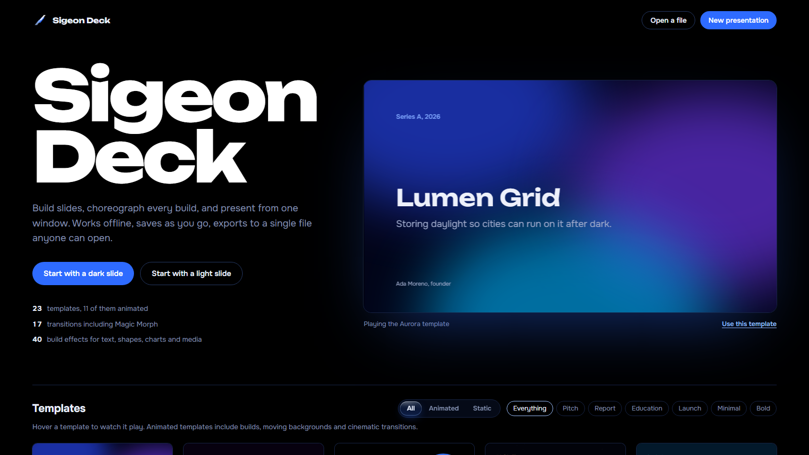

<div align="center">

# Sigeon Deck

**Build slides, choreograph every build, and present from one window.**
Sigeon Deck runs offline, saves as you go, and exports a deck to a single HTML file anyone can open.




</div>

---

## ✨ Features

- 🎨 **23 templates, 11 of them animated:** Aurora, Neon Grid, Orbit, Deep Field, Prism, Blueprint, Ember, Glass, Swiss, Terminal, Noir Lux and more
- 🎞️ **17 transitions**, including **Magic Morph**
- ⚡ **40 build effects** for text, shapes, charts and media
- 🧩 **Rich content:** text, shapes, images, charts, tables, code blocks and icons
- 🎤 **Presenter view** with speaker notes, plus a **laser pointer** and a **draw** tool for live presenting
- 🗂️ **Light table** that shows every slide at once, plus focus mode, a grid and smart guides
- ⌨️ **Command palette** (`Ctrl+K`) and full keyboard shortcuts
- 💾 **Autosave** to your browser, and **export to a single playable HTML file**
- 📦 **No dependencies:** plain HTML, CSS and JavaScript, with no build step

## 🚀 Getting started

```bash
git clone https://github.com/sigeonrestaurantstudios/SigeonDeck.git
cd SigeonDeck
```

Open `index.html` in a browser. You don't need a server or an install.

To serve it locally instead, run:

```bash
npx serve .
```

## ⌨️ Shortcuts

| Key | Action |
|---|---|
| `→` / `Space` | Next slide or build |
| `←` | Previous |
| `S` | Presenter view |
| `G` | All slides |
| `L` | Laser pointer |
| `D` | Draw |
| `Ctrl+K` | Search commands |
| `Ctrl+Z` / `Ctrl+Shift+Z` | Undo / Redo |
| `?` | Show all shortcuts |

## 🗂️ Project structure

```
SigeonDeck/
├── index.html        # App shell
├── css/app.css       # UI and template styles
└── js/
    ├── runtime.js    # Slide runtime: builds, transitions, playback
    ├── templates.js  # Template definitions
    ├── app.js        # Editor state, autosave, home screen
    ├── panels.js     # Inspector, insert panels, export
    └── glass.js      # Glass visual effects
```

## 📄 License

Sigeon Deck is licensed under the **[GNU Affero General Public License v3.0](LICENSE)**.

You may use, modify and share it, as long as:
- you **credit the original author** (Sigeon Restaurant Studios) and keep the copyright and license notices
- any modified version you distribute is **also open source** under AGPL-3.0, and that includes versions you run as a website or online service

Copyright © 2026 Sigeon Restaurant Studios

## 🤝 Contributing

Issues and pull requests are welcome. If you find a bug or have an idea for a template, open an issue.

---

<div align="center">
Made by <a href="https://github.com/sigeonrestaurantstudios">Sigeon Restaurant Studios</a> 🐦
</div>
